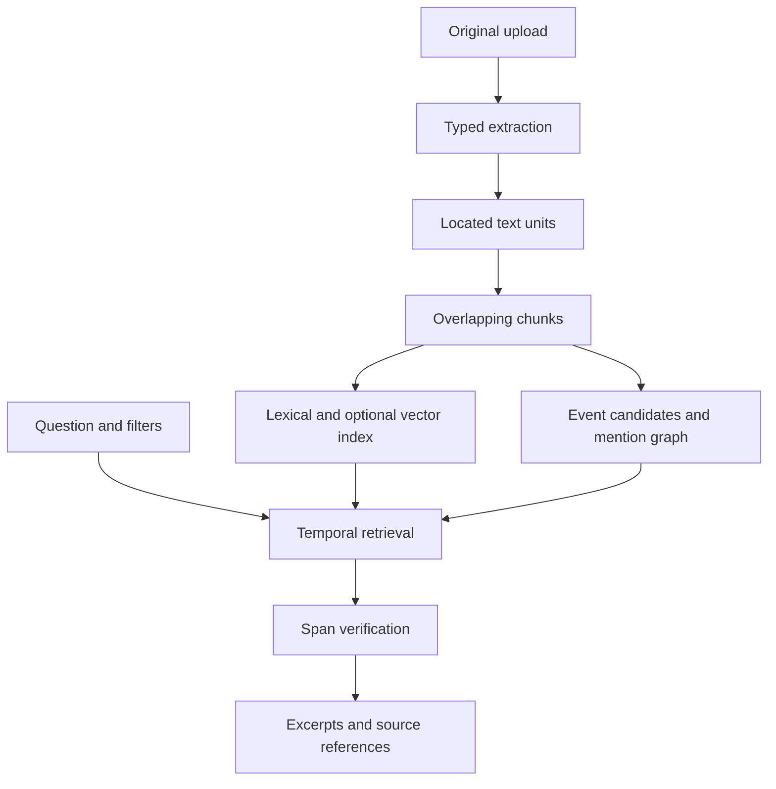

# RecallGraph — Multimodal Personal Knowledge Agent

**Milestone 1: a runnable, single-user, evidence-first backend.**

Import documents, screenshots, exported email, web-page exports, and timed meeting transcripts. Retrieve what happened in a date range and inspect the original evidence. Confirm a fact or preference explicitly, update it with history, and delete its underlying source with all dependent memory.

This foundation runs without an LLM or API key from a model provider. It uses a local application API key. Optional cloud adapters add image interpretation, audio transcription and semantic embeddings. The baseline answers with retrieved excerpts, rather than generating a prose synthesis.

## Start on Windows / PowerShell

Install Python 3.11 or 3.12. Extract the ZIP, open PowerShell in `knowledge-agent`, then:

```powershell
python -m venv .venv
.\.venv\Scripts\python.exe -m pip install -e ".[dev]"
.\.venv\Scripts\python.exe setup_env.py
.\.venv\Scripts\python.exe -m uvicorn app.main:app --env-file .env --host 127.0.0.1 --port 8000 --reload --no-access-log
```

No activation script or execution-policy change is needed.

Open **http://127.0.0.1:8000/docs**. Open `.env`, copy the `APP_API_KEY` value, click **Authorize**, and paste it. Do not paste an OpenAI key into Swagger Authorize.

The server stores data in `data/recallgraph.sqlite3`. Restarting the server preserves sources and memories. Shut down with Ctrl+C.

On macOS/Linux use `python3 -m venv .venv` and `.venv/bin/python` in place of the Windows executable.

## Three demos

### 1. Pricing last month

In `POST /v1/sources`, upload `examples/pricing-september.md` with:

```text
occurred_at = 2026-09-18T10:00:00+05:30
allow_cloud = false
```

Then use `POST /v1/ask`:

```json
{
  "question": "What did we decide about Starter pricing?",
  "start_date": "2026-09-01",
  "end_date": "2026-10-01"
}
```

The result includes USD 99, a chunk ID, exact extracted-text offsets, original file hash, and an authenticated original download endpoint. `end_date` is exclusive. Date boundaries use `APP_TIMEZONE`, default `Asia/Kolkata`.

On October 27, 2026, `"What did we decide about pricing last month?"` resolves to September. Relative dates follow the runtime clock; the explicit range above remains reproducible later.

Also import `pricing-october.md` with `occurred_at=2026-10-20T10:00:00+05:30`. Query October to retrieve the changed USD 149 price. The two observations remain separate until you confirm an updated memory.

### 2. Find the deployment screenshot

Upload `examples/deployment-screenshot.png` with cloud disabled. Local image OCR requires Tesseract on PATH; the Docker image includes it. Then:

```json
{"question": "Find the screenshot with deployment architecture"}
```

The query infers `modality=image`, returns OCR text and the original image reference. This sample is a synthetic text screenshot for testing OCR. Diagram understanding requires opt-in cloud vision. OCR spans refer to extracted text, not pixel bounding boxes.

If Tesseract is unavailable on Windows, use the Docker option below or install it locally. Document, email, HTML and transcript demos work without it.

### 3. My meeting commitments

Upload `examples/meeting.json`. Leave `occurred_at` blank: this example embeds its date. Then:

```json
{
  "question": "What commitments did I make?",
  "start_date": "2026-10-26",
  "end_date": "2026-10-27",
  "speaker": "Bhanu",
  "modality": "meeting"
}
```

The result contains Bhanu's commitment, a segment from 12.5 to 22 seconds, and the original JSON reference. Anonymous transcription speaker labels require a verified mapping before you can identify which person is you. Without `speaker`, results retain each speaker label and do not claim every commitment belongs to the user.

## What works now

| Input | Extraction | Location in citation |
|---|---|---|
| TXT / Markdown | UTF-8 text | Document unit + character span |
| PDF | Text from every page | Page + extracted-text span |
| DOCX | Main document paragraphs | Paragraph + text span |
| Exported `.eml` | Headers + readable MIME body | Message-ID + text span |
| Exported HTML | Text; scripts/styles excluded | Exported document + text span |
| PNG/JPEG/WebP | Local Tesseract OCR | Image + OCR-text span |
| PNG/JPEG/WebP with opt-in | Cloud vision description/transcription | Image + generated-description span |
| Transcript JSON | Validated timed segments | Start/end seconds + supplied speaker label |
| MP3/WAV/M4A/MP4/WebM with opt-in | Cloud diarized transcription | Segment start/end + provider speaker label |

PDFs containing a page with no extractable text are rejected, so a partially scanned file is not silently treated as fully indexed. OCR those PDFs before upload. DOCX headers, footnotes, comments and images are outside this extractor. Email attachments are not ingested automatically. Video uses the audio transcription route; video-frame understanding is a future milestone.

Live URL fetching is not implemented; export a web page as HTML. This avoids introducing a network crawler into the first milestone.

## Memory behavior

| Layer | Current implementation | Lifecycle |
|---|---|---|
| Working | Current query plan and retrieved evidence bundle | Request-scoped; no stored chat or answer cache |
| Episodic | Source-dated decision/commitment candidates | Retains provenance; expires or cascades with source |
| Semantic | User-confirmed key/value facts with evidence chunks | Versioned by explicit replacement; source-supported |
| User preferences | Explicit user-entered key/value records | Versioned; optional expiry; no inferred preferences |

1. **Remember:** import evidence; extracted events remain candidates.
2. **Retrieve:** resolve temporal/modality/speaker filters before lexical or vector ranking.
3. **Consolidate:** `GET /v1/memory/candidates` groups identical normalized quotes. This is deterministic deduplication, not semantic merging or a background agent.
4. **Confirm:** `POST /v1/memories` records a user-reviewed fact or explicit preference.
5. **Update:** a confirmed memory with the same `kind` and `key` deactivates the old version and records `supersedes`. Historical evidence remains queryable.
6. **Forget:** source deletion cascades to original bytes, units, chunks, FTS entries, vectors, events, graph mentions and every memory depending on those chunks. If a memory has several supports, losing any support conservatively deletes the entire memory.

Example after copying a real `chunk_id` from `/v1/ask`:

```json
{
  "kind": "semantic",
  "key": "pricing.starter",
  "value": "Starter price is USD 99 per month as of September 18, 2026.",
  "support_chunk_ids": ["PASTE_REAL_CHUNK_ID"]
}
```

An explicit preference does not need document support:

```json
{"kind": "preference", "key": "answer.style", "value": "Concise answers with evidence first"}
```

Semantic memory support is checked for existence and span integrity. Semantic entailment of your manually confirmed value is not model-validated. Active supported memories appear as separate `confirmed_memory_context` when their evidence is retrieved. Preferences are stored and inspectable; applying them to generated answers is deferred to the synthesis layer.

Old memory versions do not become active again when a replacement expires or is deleted. Unknown dates stay unknown: ingestion time is recorded separately and is never treated as a meeting date.

## Retrieval and provenance



- SQLite FTS5 with BM25 is the offline baseline. Every meaningful query term must match after stopword removal and stemming. This favors precision and abstention; use short content terms for local queries.
- Opt-in OpenAI embeddings are stored per chunk alongside their model name. Query vectors use the same configured model and 256 dimensions. Filtered cosine ranking and lexical ranking are merged by reciprocal rank fusion.
- A `0.30` cosine floor is a prototype heuristic, not a calibrated confidence measure. Cosine scan is capped at 5,000 filtered vectors. The next scale step is Qdrant.
- The graph currently contains rule-derived topics/email addresses and `mentioned_in` links to evidence chunks. It does not infer interpersonal relationships or perform graph traversal expansion in retrieval.
- Event extraction uses transparent English line patterns such as `we agreed`, `I will`, `Decision:` and `Action item:`. These are fallible candidates, not verified commitments.
- Relative windows supported now: `today`, `yesterday`, `last month`. Other periods require explicit dates. Time filters use source occurrence time; a future milestone adds event-specific dates and due dates.
- Each citation is checked against `unit.text[start_char:end_char]`. Original SHA-256 and retained original bytes let you verify the source. Exact extracted-text provenance does not establish that OCR, transcription or a vision description is factually correct.
- Empty retrieval produces an explicit abstention. The current answer is extractive, with no free-form LLM claim generation or tools acting on document instructions.

## Cloud adapters — optional

In `.env`, set `CLOUD_ENABLED=true` and `OPENAI_API_KEY`, then restart. Each upload or query still needs `allow_cloud=true`.

| Setting | Default |
|---|---|
| `VISION_MODEL` | `gpt-4.1-mini` |
| `TRANSCRIPTION_MODEL` | `gpt-4o-transcribe-diarize` |
| `EMBEDDING_MODEL` | `text-embedding-3-small` |

Cloud upload consent covers extraction where needed **and embeddings of the extracted chunks**. Cloud query consent sends the question for embedding. Local imports do not get embeddings retroactively. Re-uploading identical bytes returns the existing source and does not change metadata or indexing; reindex support is a future milestone. Do not change embedding models in place without a reindex plan: mismatched model vectors are excluded from semantic retrieval.

The audio adapter requests `diarized_json` with `chunking_strategy=auto`. Changing it to a model that lacks this response format will fail explicitly. Vision calls set `store=false`; this does not guarantee removal from all provider operational systems. A source deletion affects the local application, not provider retention.

Cloud request contracts have mocked tests. No paid live API calls were made while building this milestone. Model access and quality must be verified with your own test files and account before relying on them.

## Retention

Provide `retention_days` on import or memory confirmation to set expiry. Omit it to retain until explicitly deleted. The API prunes expired data at startup and before authenticated requests. To prune while the API is idle:

```powershell
.\.venv\Scripts\python.exe -m app.prune
```

Run that command under your own task scheduler if you need wall-clock cleanup while the application is otherwise inactive. There is no background scheduler in this milestone. API reads cannot retrieve an already-expired source because pruning runs first.

Deletion is a logical application-level guarantee. SQLite/WAL files, filesystem snapshots, external backups, copies already downloaded by users and cloud provider retention need separate handling. `secure_delete` is enabled, but this is not a certified forensic-erasure implementation. The database is not encrypted at rest; protect the local machine and data directory.

## API map

All `/v1/*` routes require `X-API-Key`. `/health`, `/docs` and the OpenAPI schema are public.

| Method | Route | Purpose |
|---|---|---|
| POST | `/v1/sources` | Multipart import; optional occurrence date/retention/cloud consent |
| GET | `/v1/sources` | Latest 500 source metadata records |
| GET | `/v1/sources/{id}` | Text units and chunk IDs |
| GET | `/v1/sources/{id}/original` | Authenticated attachment download |
| DELETE | `/v1/sources/{id}` | Cascading forget |
| POST | `/v1/ask` | Filtered evidence retrieval |
| GET | `/v1/evidence/{chunk_id}` | Verify and inspect citation |
| GET | `/v1/memory/candidates` | Up to 1,000 event rows grouped by normalized quote |
| POST | `/v1/memories` | Explicit confirmation/update |
| GET | `/v1/memories` | Active memories; `include_history=true` adds superseded versions |
| DELETE | `/v1/memories/{id}` | Delete memory record; source evidence remains |
| GET | `/v1/graph` | Up to 200 entities and 500 evidence mention edges |
| POST | `/v1/retention/prune` | Idempotent maintenance run |

Upload cap: 20 MiB. Extracted text cap: 500,000 characters. PDF cap: 300 pages. Imports execute synchronously and commit atomically after extraction/embedding. Concurrent identical imports resolve to the same hash-identified source. These caps are prototype controls, not a hostile-file sandbox. Multipart spooling occurs before endpoint size checks; deploy ingress body limits before exposing uploads publicly.

The app uses one shared API key for one local owner. It has no account registration, tenant isolation, authorization roles, rate limiting or external deployment. Use synthetic data for demos. The Compose configuration binds to localhost.

## Docker option

```powershell
python setup_env.py
docker compose up --build
```

Swagger is at the same localhost address. Docker installs Tesseract and uses a named data volume. `docker compose down` preserves it. The container runs as a non-root user. Image building requires network access. This configuration is provided but was not built or run in the implementation environment.

## Tests and evaluation

```powershell
.\.venv\Scripts\python.exe -m pytest -q
.\.venv\Scripts\python.exe evaluate.py --output docs/evaluation.json
```

The tests cover real PDF/EML/DOCX/HTML/TXT/transcript parsing, local screenshot OCR when Tesseract is available, exact source spans, relative-time boundaries, speaker filtering, source deletion, memory supersession, retention, authentication, invalid imports and mocked cloud contracts. The OCR test skips on machines without Tesseract. See `docs/VALIDATION.md` for actual validation scope and `docs/evaluation.json` for the measured run.

The 16-case evaluation is a small, hand-authored synthetic regression corpus. It measures expected-source-and-quote hit at 5, expected abstention, exact span integrity and local retrieval latency. It is not a general multimodal or long-term memory benchmark and has no live cloud quality, token-cost or large-corpus measurements.

## Next milestones

See `docs/ROADMAP.md`. The immediate next step is structured event/entity extraction and reviewed identity mapping, followed by a grounded synthesis layer. PostgreSQL, Qdrant, worker queues, bitemporal facts, a richer graph, multimodal UI and production access controls come after the evidence and forgetting contracts are stable.

## Primary implementation references

- [FastAPI file uploads](https://fastapi.tiangolo.com/tutorial/request-files/)
- [Uvicorn settings and env files](https://uvicorn.dev/settings/)
- [OpenAI audio transcription](https://developers.openai.com/api/docs/guides/speech-to-text)
- [OpenAI images and vision](https://developers.openai.com/api/docs/guides/images-vision)
- [OpenAI embeddings](https://developers.openai.com/api/docs/guides/embeddings)

References were checked October 27, 2026. Defaults and provider capabilities can change.
